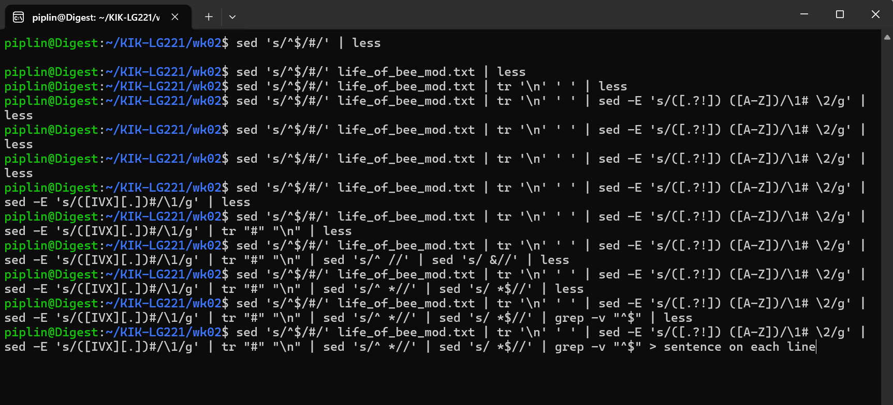

## Overall introduction to Command Line Tools for Linguists
This was a little introduction on using shell commands to navigate our computer, coding, setting up ssh connections, and using git - all through the command line environment. 

## Module 1
The first module was a general introduction to shell commands. I installed Ubuntu for Windows to get used to using linux commands even on my PC operating system. We learnt general commands like pwd, whoami, clear, and man. It was a great introduction to using a computer without the GUI we are all used to nowadays.

### Example code from module 1: 
`sort filename.txt | uniq | wc -l`   
This is a code that counts the number of unique lines in a textfile.  
First, `sort` sorts the file alphabetically, which is necessary because `uniq` only filters adjacently matching lines.  
The code then it takes the output of sorting and filters with `uniq`.  
Then the code takes that output and counts the numbers of lines using `wc` with the `-l` tag to indicate that it is the number of lines that we want to count.  
This code is a basic introduction to different shell commands and how they can be used to analyse a file, and a basic introduction to piping.

## Module 2
Module 2 was by far the hardest module of the course. We learnt about regex, which was tough even with previous experience using them. The module covered using regex for grep and egrep in order to filter and analyse data from text files. We learnt about the various steps involved in processing textfiles using command line tools. These tools were all connected to each other using pipes. Finally, the module also covered how to examine file details and change things like the file encoding type used in the system. These weeks showed me that even if a command has only one line, that line can have multiple steps and how each step builds onto the next one. A mistake at a previous step can drastically alter the intended results. 

### example code from module 2:

The example code shows the modeule's focus on regular expressions and building lines of code using pipes.   

`sed 's/^$/#/' life_of_bee.txt | tr '\n' ' ' | sed -E 's/([.?!]) ([A-Z])/\1# \2/g' | sed -E 's/([IVX][.])#/\1/g' | tr '#' '\n' | sed 's/^ *//' | sed 's/ *$//' | grep -v "^$" > output.file`

| part   | explanation   |
| ---| ---|
| `sed 's/^$/#/' life_of_bee.txt`   | take file and replace empty line with #   |
| `tr '\n' ' '`   | replace newline characters with space   |
| `sed -E 's/([.?!]) ([A-Z])/\1# \2/g'`   | take punctuation !.? followed by a space and then a capital letter and change to the format of punctuation, #, space, and then the letter do that for the whole file   |
| `sed -E 's/([IVX][.])#/\1/g'`   | find all instances of roman numerals used for numbers and remove the period-mark associated with them do that for the whole file   |
| `tr '#' '\n'`   | replace # with newline chars   |
| `sed 's/^ *//'`   | remove empty spaces at start of line   |
| `sed 's/ *$//'`   | remove empty spaces at end of line   |
| `grep -v "^$"`   | select lines that are empty  -v flag to show that we want the inverse of the empty lines   |
| `> output.file`   | save output into output.file   |

In the terminal, the following picture is what building the whole process step by step would look like. We can do one part, check that the output is as required before using the up arrow to go back to the previous command and adding the next step.   

## Module 3
In this module we started writing and saving bash scripts, and executing programs that way rather than entering commands separately in the terminal. We also started intalling and using python and nltk tooks. I think the most vital thing we learnt was how to set up a virtual environment in our system, so that we can install modules and dependencies and stuff without having to worry about it affecting our main system. Environment variables were also mentioned during this module, and we learnt to change the PATH variable to include the directory we were working in, while also creating a backup file of the original .bashrc file, just in case. I think this was one of my favourite modules, I finally felt like I was beginning to understand how certain parts of my OS works. For example, I had heard of start-up scripts before but I now know what people mean when they use that term.  

### example code from module 3:

The following table contains the general structure of a shell script, using the example of a shell program that takes a Windows text file, makes a frequency list of the words in the file and saves it to a file of the given name.    

| Script  | Purpose   |
| --- | -------|
| `#! /bin/bash` | - the path to the interpreter that should run the script  |
| `# script: nameofscript.sh`   | - a comment about the name of the script  |
| `# author (date)`  | - comment detailing author and date that the program was made  |
| `# Read a text file from standard input`  `# and compute a frequency list of the words in the text` `# print output to a standard output` `# abort the script if either $1 or $2 are missing` | - a description of what the program does   |
| `if [ $# -ne 2 ]` | - if the number of $ variables is not equal to 2    |
| `then`   | - indenting the following is standard stylistic practice  |
| `echo "ERROR: Two command line arguments required."`  `echo "$0 input_text_file output_freq_file"` | - $0 refers to the script name  - used instead of the name of the script since this way the correct error message will be printed by default |
| `exit 1`  | - 1 here is an exit code   - indicates a non-regular exit of function   |
| `fi`  | - to exit the if block  - stands for final  |
| `cat $1 \|` `dos2unix \|` `tr -s "[:space:]" "\n" \|`  `tr -d "[:punct:]" \|`  `sort \|`  `uniq -c \|`  `sort -nr > $2` | - the program  - each part is printed on a different line for sake of clarity   |

## Module 4
This final module focused on command line processes, ssh, and git. The first section was about processes run when executing them in the command line, how to identify them, kill them, or make them run in the background. The second section was how to connect to a remote server using ssh commands, and how to set up a configuration file for automatic ssh connection. It also explained how to copy files between two computers. The last section focused on how to use git in the command line environment. It showed how to initiate git or connect to an existing git repository and how it is used for version control. This week was the most fun. Plus, although we only used it shortly to test it out, connecting to a supercomputer was interesting and low-key exhilarating. 

### example code from module 4:

The code in this sections lays out the general steps to perform when working with git.    

#### General git workflow with a remote repository:    
1. Connect using:   
   `git clone <url/path> <where to clone>`
2. Work on the program, and then you want to commit changes:
   1. `git diff` _(optional, shows changes that have not been commited)_
   2. `git status` _(optional, shows files that have been edited)_
   3. `git add -A` 
   4. `git commit -m "short description of change"`   
3. Then, to push the changes to the remote repository:   
   1. `git pull origin master` _(to pull any changes that have been made in the meantime)_
   2. `git push origin master` _(where master is the name of the branch that you are working on)_   
   
   
#### Common branch workflow includes:   
1. Make a new branch
   1. `git branch newbranchname`
      * create new branch for feature you are working on
   2. `git checkout newbranchname`
      * to move to this new branch
   3. `git branch` _(optional)_
      * command that shows which branch you are currently on
   4. `git push -u origin newbranchname`
      * pushes the new branch to the remote repo
      * the tag -u tells git that we want to associate the local newbranchname with the remote newbranchname
      * then, when using git pull and git push, git will automatically know that these two branches are associated with each other   
   5. `git branch -a` _(optional)_
      * shows all branches, both local and remote
2. Then you use the general git workflow template and work on this new branch so that you are not making any changes to the master branch. Once you are done working with a branch and ready to merge it with the master branch, you can do so by:   
   6. `git checkout master`   
      - move to the master branch
   7. `git pull origin master`   
      - to pull any changes that might have been made in the meantime
   8. `git branch --merged` _(optional)_   
      - see what branches have been merged so far
   9. `git merge newbranchname`
      - merge the branches
   10. `git push origin master`
       - push the changes to the remote repository
3.  And then you can delete your branch:   
    11. `git branch --merged` _(optional)_   
    	- double check that you have merged the branch you plan to delete to master
    12. `git branch -d newbranchname`   
    	- -d to indicate that you want to delete this branch
    13. `git branch -a `   
    	- see current list of branches, can see if branch is still in remote, which it should be rn
    14. `git push origin --delete newbranchname`   
    	- delete the remote newbranchname