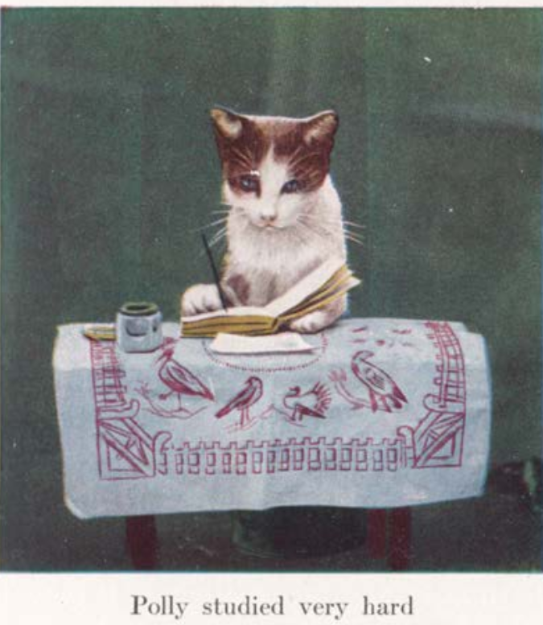

## Introduction

 Hei, my name is Aiswarya Sudhir but I go by Pip. I'm a linguistics student at the University of Helsinki. I am currently pursuing an MA in English Studies. My area of interest is language technology and speech synthesis, focusing on how we can use emerging technology to increase accessibility for people with text-processing disabilities such as dyslexia. Additionally, another field of personal academic interest is formal semantics and syntax, and examining formal theories of meaning using data we have from LLMs. 

In my spare time I love swimming, solving nonogram puzzles by hand, and game nights. Opiskelen suomea vähän vähältä - so if you have a favourite Finnish song, send it my way; I'd love to hear it! Hauska tavata!

(P.S. the picture on the right is literally me. And also it's a picture of Polly, one of [Cornelia Clarke](https://en.wikipedia.org/wiki/Cornelia_Clarke)'s cats, who she'd dress up and pose. This photo is from the book 'Peter and Polly' by Elizabeth Wilkinson, published in 1912.)

## Find me on

[LinkedIn](https://www.linkedin.com/in/aiswaryasudhir), [GitHub](https://github.com/pika-pip)

## Contact

My email address is of the form first_name.z.last_name@helsinki.fi. 

## Some courses I've taken

[Using Corpora to Analyse Discourse](https://studies.helsinki.fi/courses/course-unit/otm-37d2a212-8f9c-40a1-a3b7-c91ca135ced4/ENG-S312), autumn 2026

[Essential Tools for Language Technology](https://studies.helsinki.fi/courses/course-unit/otm-c13d30ee-e5cc-4e1c-b8b3-67883288b9a4/KIK-LG221), autumn 2026

[Theory and Method in Linguistics](https://studies.helsinki.fi/courses/course-unit/otm-236a8076-1e27-40f8-a3ae-f84e164e0823/LDA-L330), autumn 2026

[Language Policy](https://studies.helsinki.fi/courses/course-unit/otm-f4528ebd-4252-47c2-9114-877ee5d31f48/ENG-S307), autumn 2026

[Advanced programming](https://studies.helsinki.fi/courses/course-unit/otm-75c14395-dd9f-4212-89b4-41803c896274/BSCS1002), autumn 2026

[Syntax and Argument Structure](https://ugla.hi.is/kennsluskra/index.php?tab=nam&chapter=namskeid&id=70040020260&kennsluar=2025), spring 2026

[Programming for the humanities](https://ugla.hi.is/kennsluskra/index.php?tab=nam&chapter=namskeid&id=70997120256&kennsluar=2025), autumn 2025

[Vocabulary acquisition: Research and theory](https://ugla.hi.is/kennsluskra/index.php?tab=nam&chapter=namskeid&id=70699120256&kennsluar=2025), autumn 2025

## Projects

[cmdline-course](https://github.com/pika-pip/cmdline-course): A project for the Command Line Tools for linguists course, and it contains my first ever git repository.

## Misc. 

[Gotta love a good ol' rick roll](https://www.youtube.com/watch?v=dQw4w9WgXcQ&list=RDdQw4w9WgXcQ&start_radio=1) 